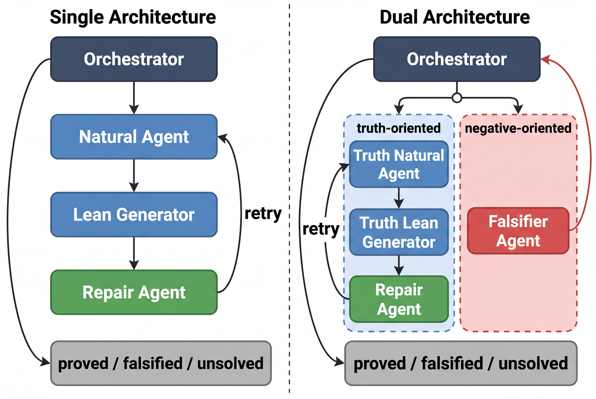

# Single and Dual LLM–Lean Architectures

## Current system: final two-goal pipeline (2026-10-20)

To move the current system to another computer, follow
[CURRENT_SETUP.md](docs/CURRENT_SETUP.md). It includes installation, credentials,
an offline check, and a plan-only command before making paid model calls.
The confirmed role inputs, memory boundaries, budgets and evaluated source
hashes are documented in [FINAL_PIPELINE.md](docs/FINAL_PIPELINE.md).

- Single chooses one of the proof/refutation goals each round and reads its own history.
- Dual searches both fixed Lean goals and reads both previous-round histories.
- Orchestrator plans Lean implementation; Natural independently derives an argument;
  Generator writes Lean; Repair gives retry guidance only.
- The shared original prompts are retained. The numbered-step experiment was not adopted.
- Config: [two_goal_experiment.env](configs/two_goal_experiment.env), Luna Pro planner
  and Luna workers, 3 rounds × 3 attempts **per lane**.
- Expanded data: [150 public problems (121 + Judson 29)](data/book150_v1/README.md),
  with evaluator-only labels and separate Lean reference certificates.
- Selected data: [144-problem outcome-selected subset](data/book144_posthoc_v1/README.md).
  Its six exclusions were chosen after inspecting results; it is a development/
  exploratory subset, not an independent final test. The full 150 set is retained.
- Original data: [121 public problems](data/book121_v1/problems.jsonl),
  [evaluator-only labels](data/book121_v1/labels.jsonl), and
  [121 reference answers with Lean certificates](data/book121_v1/ground_truth/README.md).
- Balanced22 exploratory run: Single **15/22**, Dual **16/22**. See
  [the full report](docs/balanced22_results_20261017.txt).

The current route uses OpenRouter; Codex CLI authentication is not required for
this configuration. Local audit logs work without LangSmith. Raw local runs,
credentials, scratch files, and the draft manuscript are not part of this release.

## Archived paper reproduction

The remaining instructions and results below describe the older 100-problem
experiment and its historical architecture, not the current two-goal system.
For the original implementation, check out commit `7cff2a7`; current `main`
also contains subsequent shared-backend changes and is not byte-identical to
the archived paper implementation.

This repository is the reproducibility package for an experiment comparing two
LLM–Lean architectures on a mixture of true and false mathematical statements.

- **Single** uses one formalization path without assuming that the statement is
  true or false.
- **Dual** runs a truth-oriented formalization path and a falsity-oriented
  natural-language path, then combines their evidence conservatively.

The public evaluation subset contains 100 problems: 50 true statements and 50
false statements. The false statements are balanced across five mutation types.

## Architecture

<p align="center">
  
</p>

## Reported results

| Architecture | True Solved | True Not Solved | Mean Rounds to Solve | False Detected | False Not Solved |
|---|---:|---:|---:|---:|---:|
| Single | 35 | 15 | 1.14 | 0 | 50 |
| Dual | 38 | 12 | 1.16 | 24 | 26 |

Neither architecture classified a true statement as false in the reported run.
The raw per-problem results are
[`single.jsonl`](results/paper/single.jsonl) and
[`dual.jsonl`](results/paper/dual.jsonl).

## Repository layout

```text
.
├── configs/                 # Exact model and budget settings
├── data/                    # 100 problems and evaluator labels
├── docs/                    # Architecture figure
├── results/paper/           # Reported Single and Dual results
├── scripts/                 # Setup, run, validation, and summary commands
└── src/                     # Single and Dual implementation
```

## Requirements

- macOS or Linux
- Python 3.11 or newer
- Git
- Elan and Lean/Lake
- Codex CLI with an authenticated OAuth session
- An OpenRouter API key

The reported environment used:

- Python 3.13.3
- Lean 4.27.0 through the pinned miniF2F checkout
- Codex CLI 0.139.0
- miniF2F commit `f0a20e14c1eeccd859d51bb4c2b3ee487889c303`

## Installation

```bash
python3 -m venv .venv
source .venv/bin/activate
python -m pip install --upgrade pip
python -m pip install -e .
```

Prepare the pinned miniF2F checkout:

```bash
scripts/setup_minif2f.sh
```

Authenticate the Codex CLI, then prepare the OpenRouter environment:

```bash
codex login
cp .env.example .env
```

Set `OPENROUTER_API_KEY` in `.env`. Never commit `.env`.

Optionally enable the repository's secret check before each commit:

```bash
git config core.hooksPath .githooks
```

The hook rejects common API-key formats, non-empty secret assignments,
credential files, and machine-specific home-directory paths.

## Reproduce one set

The command requires `--run` because it makes paid model calls:

```bash
scripts/run_paper_experiment.sh --set 01 --mode both --run
```

Valid sets are `01` through `05`. Valid modes are `single`, `dual`, and `both`.
New output is written under `.runs/paper/`.

To run all five sets:

```bash
for set_number in 01 02 03 04 05; do
  scripts/run_paper_experiment.sh --set "$set_number" --mode both --run
done
```

Model routing is strict. No unconfigured model fallback is allowed:

- Natural, False Reasoner, and Repair/Retry agents:
  `openai/gpt-5.4-nano` through OpenRouter
- Orchestrator and Lean Generator: `gpt-5.4` through Codex CLI OAuth

The historical CLI option is named `--nature-model`; it routes the Natural
Agent and is retained to avoid changing the evaluated implementation.

## Recreate the result table

```bash
python scripts/validate_release.py
python scripts/summarize_results.py
```

Use new run outputs instead:

```bash
python scripts/summarize_results.py \
  --results-root .runs/paper \
  --data-root data
```

## Important reproducibility note

The reported Dual run supplied the Falsifier output as `counter_reasoning`
inside the third truth-memory record. The current improved implementation can
instead expose `truth_memory` and `falsifier_memory` as separate schema fields.
The paper reproduction script explicitly selects the historical
`paper_merged` layout. See [REPRODUCIBILITY.md](REPRODUCIBILITY.md) before
interpreting or extending the results.

LLM API outputs are non-deterministic and provider-side model aliases can
change. This repository reproduces the evaluated pipeline, prompts, data,
budgets, routing, and evaluator, but it cannot guarantee byte-identical model
responses.

## Check the package

```bash
python scripts/check_secrets.py
python scripts/validate_release.py
python scripts/summarize_results.py
python -m compileall -q src scripts
```

## Data and evaluation keys

[`data/problems.jsonl`](data/problems.jsonl) contains the 100 model inputs.
[`data/labels.jsonl`](data/labels.jsonl) contains the gold labels and
mutation/repair information used only by the final conservative checker.
See [REPRODUCIBILITY.md](REPRODUCIBILITY.md) for the exact protocol.

## License and citation

A source-code license and final citation metadata must be selected by the
authors before making the GitHub repository public. The miniF2F source should
be cited and used under its upstream terms.
